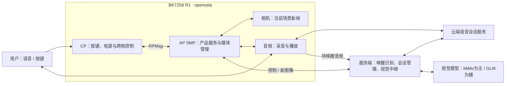

# 视障随行视觉辅助胸牌

面向陌生室内场景的语音视觉辅助原型，基于BK7258 R1与openvela构建。

用户可以用语音或按键开启交互，询问眼前的入口、门牌、标识和公共设施。设备获取当前场景的新照片，经服务端调用视觉模型理解后，在同一场语音对话中回答；用户可继续提问或换个方向再看一次。胸牌补充可见环境的语义信息，与日常出行辅助工具配合使用。

## 产品交互

| 能力 | 使用方式 |
| --- | --- |
| 开启对话 | 开机就绪后，短按中键或说出唤醒词 |
| 语音问答 | 围绕当前需要了解的信息自然提问 |
| 按需观察 | 说“帮我看看前面有什么”，获取一张新照片并语音回答 |
| 连续观察 | 换个拍摄方向说“现在再看一眼”，在原会话中获取新画面 |
| 退出与音量 | 中键短按退出，左右键调整十档音量；默认五档并保存手动选择 |
| 电源控制 | 中键长按三秒控制开关机 |

视觉回答围绕用户当前目标，优先给出位置线索、标识文字和关键物体信息。MiMo为主要视觉模型，GLM为可选辅助后端；通过配置显式选择，不进行隐式切换。

## 系统架构

设备端负责采集、播放、按键、电源与资源生命周期；服务端负责唤醒识别、会话网关及视觉中继，可部署在具备相应运行环境的主机上。物理CPU0运行CP openvela/NuttX，物理CPU1和CPU2组成一个AP SMP实例。

## 选题与平台适配

作品以新硬件平台适配和应用集成为技术主线：完成R1的CP/AP配置与系统集成、跨核控制、标准Audio/Video接口接入，以及语音和新图像在同一业务中的资源协调。

LCD与LVGL用于显示驱动及openvela图形组件适配验证，属于平台覆盖范围，不作为视障用户的产品交互功能。芯片/板级/应用各层的基础代码与本项目适配、功能修改分别见[模块与贡献说明](docs/porting/README.md)。

## 目录导航

| 目录 | 内容 |
| --- | --- |
| `chips/bk7258/` | CP/AP启动、多核、跨核通信与芯片侧驱动 |
| `boards/bk7258/` | 板级器件、引脚、配置、分区及初始化 |
| `app/vision_badge/` | 对话、观察、音频、唤醒、三键和电源服务 |
| `app/bsp_diag/` | 平台状态与基础诊断 |
| `tools/agora/` | 服务端会话、ASR与视觉中继 |
| `tools/bk7258/`、`config/` | 固定依赖、构建与镜像检查 |
| `docs/` | 面向使用者和开发者的架构、运行及适配说明 |
| `evidence/` | 按验证主题组织的版本、系统与媒体记录 |

## 构建与运行

1. 在Ubuntu准备openvela工作区、固定依赖、工具链与SDK，仓库目录名保持不变。
2. 使用`team441_cp_power`与`team441_ap_product`成对配置，通过`tools/bk7258/bk7258.py`构建并检查镜像；按分区烧录，保留校准与用户数据。
3. 配置并启动服务端，为设备配置网络与鉴权；设备就绪后通过中键或唤醒开始使用。

完整步骤和参数见[构建与运行](docs/build-and-run.md)，服务端职责见[服务端部署](docs/server.md)，系统关系见[系统架构](docs/architecture.md)。

## 开发与验证

开发规则和Review流程见[CONTRIBUTING](CONTRIBUTING.md)，具体问题的分析、修改与检查见[开发案例](docs/development-cases.md)。[平台适配Skill](.agents/skills/bk7258-openvela-porting/SKILL.md)提供板型输入、接口合同和交付审查流程。

## 许可证

本项目代码采用[Apache-2.0](LICENSE)，第三方框架、SDK和公开基础的版权头及许可证保持，详见[组件声明](THIRD_PARTY_NOTICES.md)。
